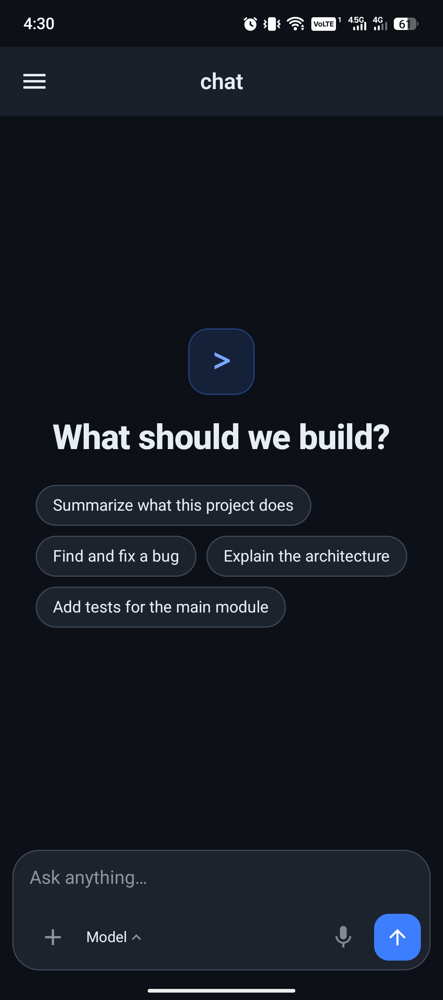

# Cody

An Android app that brings the [opencode](https://opencode.ai) AI coding agent to your phone, with
the whole runtime self-contained on the device. No server, no root, no cloud account.

> Previously called *OpenCode for Android*. It is still the opencode agent — only the app's own
> name and branding changed to **Cody**, so the launcher, the in-app mark and this README all agree.
> See [Why is the applicationId `com.termux`?](#why-is-the-applicationid-comtermux) for why the
> *package* name could not follow.

## What this is

A native Android application (Kotlin + Jetpack Compose, Material 3) that embeds an **open-source
Termux backend** as its workspace and runs **opencode inside a Debian container**:

```
┌──────────────────────────────────────────────────────────────┐
│ Cody (Kotlin · Jetpack Compose UI)                             │
│                                                               │
│  Chat (default)          TerminalActivity (TerminalView)      │
│───────────────────────────────────────────────────────────────│
│              OpenCodeService (foreground service)             │
│───────────────────────────────────────────────────────────────│
│  Termux rootfs  /data/data/com.termux/files/usr               │
│    • bash, apt/dpkg, proot-distro, git, curl, ripgrep, node   │
│───────────────────────────────────────────────────────────────│
│  Debian rootfs (proot-distro, glibc)  ──►  opencode           │
└──────────────────────────────────────────────────────────────┘
```

- **Termux terminal emulator** (`terminal-emulator` + `terminal-view`) provides a real
  `xterm-256color` PTY with ANSI/256/truecolor rendering, mouse tracking, text selection and
  copy/paste.
- **Embedded Termux rootfs** is unpacked from an architecture-specific bootstrap archive that is
  compiled into the APK as `libtermux-bootstrap.so`. This gives you a working `bash`, `apt`, and
  `proot-distro` with zero user setup.
- **proot-distro + Debian** is installed into the Termux prefix. Debian is where opencode actually
  runs, because opencode's official Linux builds expect a standard glibc environment.
- **opencode** is installed inside Debian via the official installer.

Everything, including the AI provider traffic, happens on-device. The app ships no analytics and no
ads.

## Features

- **Chat interface** (the default): a Claude Code-style conversation view with streaming replies,
  collapsible reasoning, live tool-call cards and a composer. The raw shell is one tap away.
- **Model picker**: free models only. A search field, a `no images` marker on text-only ones, and an
  **Auto · free** entry at the top that picks the strongest available free model for you. Selection
  is per session and restored when you reopen it.
- **Drawer**: recent conversations with relative timestamps, swipe-to-delete, long-press rename
  (the rename is written through to both the local store and `PATCH /session/:id`, so it survives a
  restart and shows on the server). Also holds Files, *Connect a provider* and Setup.
- **Dictation**: on-device Whisper, installed by an optional provisioning step. Tap the mic to start,
  tap again to stop — the transcript lands in the composer with no intermediate "transcribing" state.
- **Stays awake while you use it**: `FLAG_KEEP_SCREEN_ON` rather than a `WakeLock`, so there is no
  permission to request and it cannot outlive the app.
- **Agent / mode switcher**: `build`, `plan` and anything else registered in `GET /agent`, sent along
  with each prompt.
- **Attachments**: attach a picture or any document from the composer; the bytes are inlined as a
  `data:` URI because the Debian container cannot see Android storage. Images get a live thumbnail.
- **Permission and question prompts**: when opencode asks to run a tool or offers choices, the app
  shows an allow-once / always / reject sheet or a tappable option list instead of hanging.
- **Keeps running after you leave**: a foreground service owns the server and the prompt is executed
  on a process-wide scope, so exiting the app does not cancel a reply in flight.
- **In-app browser**: tappable links in any reply, provider sign-in pages, and the official
  `opencode web` dashboard (`http://127.0.0.1:4173`) in one WebView screen.
- **3D preview**: `.glb` files the agent exports open in an orbitable viewer (bundled
  `<model-viewer>`, served from a loopback origin so WebGL is not cross-origin blocked). Blender's
  CLI is installed in Debian for headless model work.
- **File delivery**: a Files sheet lists what the agent wrote (Termux home, Debian `/root`, shared
  `/tmp`) and hands it to you through the system share sheet or straight to Downloads — zip, apk,
  images, screenshots, anything.
- One-tap environment setup with live streaming logs, plus a tooling step that installs `gh`,
  the Vercel CLI, the Supabase CLI and Blender inside Debian.
- Works behind corporate TLS inspection: setup mirrors the device trust store (system **and** user
  CAs) into the Termux and Debian CA bundles before anything downloads, and can accept a root CA
  that only exists on your machine — see [Corporate networks](#corporate-networks--tls-inspection).
- Full terminal: extra-keys bar (Ctrl, Alt, Shift, Esc, Tab, arrows, Home/End, Ctrl+C/D/Z), pinch to
  zoom, Ctrl-C shortcut, copy & paste.
- The **opencode TUI**, a **Termux shell**, and a **Debian login shell** are all reachable from the
  drawer when you want the raw thing instead of the chat UI.
- Foreground service keeps your sessions alive in the background.
- Dark UI built around the Cody mark — a rounded square with two eyes and a smile, drawn once and
  reused by the drawer, the initialising screen and the launcher icon.

## Preview

| Chat | Drawer | Terminal |
| --- | --- | --- |
|  |  |  |

Everything above runs on the phone alone — the streaming chat, the drawer and the terminal are all
the real app, not a mock-up.

## Installation

You do not need a PC, a root tool or an account to install Cody.

1. Get the APK. Each build of `main` publishes a signed APK; grab it from the
   [Actions tab](https://github.com/delishworks-design/cody/actions) → open the latest green
   **Build release APK** run → **Artifacts** → download `cody-release-apk` and unzip it. Inside is
   `cody-<date>-<n>.apk`.
2. Uninstall the official Termux app first if you have it. Only one app on a device can own the
   `com.termux` package id (see [Why is the applicationId `com.termux`?](#why-is-the-applicationid-comtermux)),
   and Cody needs it.
3. Open the APK on your phone and allow installing from your file manager when Android asks.
4. Open Cody and wait. The first run provisions itself — see [First run](#first-run).

That is the whole flow. There is no server to start, no key to paste, and nothing to sign in to.

> Prefer to build it yourself instead? See [Building](#building).

## Requirements

- Android 7.0 (API 24) or newer. A **64-bit device** (arm64-v8a) is strongly recommended.
- ~1.5 GB free storage for the two root filesystems plus opencode.
- Internet connection for the initial setup.
- No API key needed to try it. Three providers are connected out of the box — **Kilo Gateway**
  (anonymous access to its `:free` models, no account), plus opencode's own and xkiro — which is
  roughly 1100 free models. The picker lists **free models only**, and the default selection is
  **Auto · free**, which picks the strongest available free model and rotates to the next one when
  the current one is rate-limited. Bring a provider key later if you want paid models; that is
  configured inside opencode, on device, under *Connect a provider* in the drawer.

## Building

### Prerequisites

| Tool          | Version            |
| ------------- | ------------------ |
| JDK           | 17                 |
| Android SDK   | Platform 35, Build-Tools 35 |
| Android NDK   | 27.2.12479018      |
| Gradle        | 8.10.2 (wrapper)   |

The build packages the Termux rootfs for `arm64-v8a` and `x86_64`.

### 1. Fetch the Termux bootstraps

```powershell
powershell -ExecutionPolicy Bypass -File scripts/fetch-bootstraps.ps1
```

This caches the bootstrap archives in `.cache/bootstraps/`.

### 2. Set the SDK path

`local.properties` should point at your SDK:

```properties
sdk.dir=C:/Users/you/AppData/Local/Android/Sdk
```

### 3. Build

```powershell
gradle -p . :app:assembleDebug
```

The APK lands in `app/build/outputs/apk/debug/app-debug.apk`.

> **Note:** `ndk-build` does not support spaces in paths. If your checkout lives under a path with
> spaces (this repository does), the Gradle build transparently cross-compiles the native code in a
> space-free temporary directory and copies the `.so` files back. You do not need to do anything.

## Why is the applicationId `com.termux`?

The Termux bootstrap binaries and shared libraries are compiled with the absolute prefix
`/data/data/com.termux/files/usr` **hard-coded**. For the embedded backend to work, the app's private
data directory must therefore be `/data/data/com.termux`. This is why the internal applicationId is
`com.termux` even though the app is branded **Cody**.

Consequences:

- Only one app on the device can own `com.termux`. Do not install this alongside the real Termux app.
- The app is branded "Cody" in the launcher and UI; only the package identifier is `com.termux`.
- `targetSdk` is pinned to **28** and must stay there. On API 29+ an app may not `exec()` files from
  its own writable data directory — and the entire Termux rootfs lives in exactly that directory, so
  raising it breaks `bash`, `apt`, `proot` and therefore opencode.

If you want a different applicationId you must rebuild the Termux bootstrap packages with the new
prefix — see the [Termux packaging docs](https://github.com/termux/termux-packages).

## First run

There is no onboarding and no setup button to hunt for. The app goes straight to the chat screen and
provisions itself in the background:

1. Open the app. The chat screen appears immediately; provisioning starts behind it.
2. Wait for the embedded Termux environment to unpack and for Debian + opencode to install. The
   Cody mark blinks on the initialising screen while this happens — a fresh install genuinely takes
   a few minutes, and a silent wait reads as a hang.
3. The screen hands over to the chat as soon as the server answers. Type and send.
4. Nothing to configure for a first reply — free models are already connected. To add a paid
   provider, open the drawer and use *Connect a provider*.

If provisioning is interrupted, it resumes rather than restarting: the provisioner records how far it
got and skips completed steps on the next launch. *Setup* in the drawer re-runs it on demand, and the
**Run setup again** button on the ready panel forces a fresh pass.

Optional: a **Termux shell** and a **Debian login shell** are reachable from the drawer for
apt/node tooling and a plain Debian bash respectively.

## Environment provisioning

Setup is implemented as plain shell scripts under `app/src/main/assets/provision/`. They are
unpacked to `$HOME/.opencode-provision/` and executed in order, so they can be re-run after a
partial failure without repeating completed work:

| Script                    | What it does                                                            |
| ------------------------- | ----------------------------------------------------------------------- |
| `00-tls-sync.sh`          | Merge Android trust anchors into the Termux CA bundle, verify HTTPS      |
| `01-apt-update.sh`        | Refresh the Termux package lists                                         |
| `02-install-tools.sh`     | Install `proot-distro`, `git`, `ripgrep` (each individually)             |
| `03-install-debian.sh`    | Download Debian — skipped if either rootfs layout already exists         |
| `04-debian-tls.sh`        | Copy the trust anchors into the Debian rootfs, run `update-ca-certificates` |
| `05-install-opencode.sh`  | Install opencode in Debian and export `~/.opencode/bin` on `PATH`         |
| `06-install-tooling.sh`   | Install `gh`, the Vercel CLI and the Supabase CLI inside Debian           |
| `07-install-blender.sh`   | Install Blender's CLI (apt, else the portable tarball) for headless 3D work |
| `08-fix-tls.sh`           | Re-enable peer verification, per side, where it actually works          |
| `verify-opencode.sh`      | Confirm opencode is reachable (prints its path or `OPENCODE_MISSING`)    |

`06` and `07` are **optional** steps (`OPTIONAL_STEPS` in `EnvironmentProvisioner`): they are
attempted and their output is shown, but a failure — a blocked npm registry, a too-heavy apt
dependency graph — never marks the setup as failed, because opencode itself is verified
separately. Both scripts are idempotent and always exit 0.

`04` and `08` do not *assume* verification can be restored — they probe a real HTTPS request and
only turn it on where it passes. Silently keeping it off for everyone would weaken every later
`apt-get` the agent runs; turning it on when the root CA is genuinely absent would break them
instead. On a network whose CA is missing, setup still completes and says so, with the path to drop
the CA at.

Four steps work around proot and packaged-tool limitations that are worth knowing about before
debugging them again:

- **`03` patches Python's SSL.** proot-distro fetches the rootfs with `urllib`, and Python has no
  environment variable for "skip verification", so the script sets
  `ssl._create_default_https_context = ssl._create_unverified_context` before handing over to
  `runpy.run_path`. Only the rootfs download needs this; everything later goes through curl and
  honours the real bundle.
- **`06` installs the Vercel CLI with bun, not npm.** npm's `cacache` writes blobs by renaming a
  temp file into a content-addressed path, and that `rename()` reports `ENOENT` under proot on
  every cache location — `/root`, `/tmp` and `/dev/shm` all fail identically. bun is a single
  static binary with its own resolver, so it sidesteps the cache entirely. Supabase ships a
  standalone tarball, and `gh` comes from apt, so neither is affected.
- **`07` also installs `python3-numpy`.** Blender's glTF exporter imports numpy unconditionally and
  Debian does not bundle it, so without this `bpy.ops.export_scene.gltf` dies with
  `ModuleNotFoundError` and no `.glb` can be produced.
- **`04` removes a stale `opencode-extra-anchors.crt`.** Copying the hand-added CA into the rootfs
  without deleting it when the source file is gone would leave a revoked or replaced CA trusted
  inside the container, and the step would report anchors that are no longer on the device.

### Corporate networks / TLS inspection

On networks that intercept HTTPS, the trust anchor is a private CA installed on Android as a
**user** certificate. Apps targeting API 24+ (this app targets 28) ignore user CAs unless they are
declared in `res/xml/network_security_config.xml`, so setup opts in to them, enumerates the trust
anchors through the default `TrustManager`, and writes them to `$PREFIX/etc/tls/opencode-anchors.pem`
(`TlsTrustSync.kt`).

That one bundle file — `$PREFIX/etc/tls/cert.pem` — is what curl (compiled-in path), python
(`openssl_cafile`) and apt (GnuTLS) all verify against, so no environment variables are needed and
nothing leaks into the proot container. The anchors are then copied into the Debian rootfs as well.

If HTTPS still fails, the setup log says so explicitly and points at
*Settings → Security → Encryption & credentials → Install a certificate → CA certificate*.

**When the CA is not on the device at all.** Some corporate setups install the root into the
*machine's* certificate store (Windows/macOS) and never push it to enrolled devices — an emulator,
or a phone that joined Wi-Fi before enrolment. In that case mirroring Android's trust store proves
the CA simply is not there, and nothing the app can enumerate will help. Export it from the host and
drop it in by hand:

```powershell
$c = Get-ChildItem Cert:\CurrentUser\Root, Cert:\LocalMachine\Root |
     Where-Object { $_.Subject -match 'Your Corp' } | Select-Object -First 1
"-----BEGIN CERTIFICATE-----`n" + [Convert]::ToBase64String($c.RawData, 'InsertLineBreaks') +
  "`n-----END CERTIFICATE-----" | Set-Content corp-ca.crt -Encoding ASCII

adb push corp-ca.crt /data/local/tmp/corp-ca.crt
adb shell run-as com.termux cp /data/local/tmp/corp-ca.crt files/usr/etc/tls/extra-anchors.pem
adb shell run-as com.termux /data/data/com.termux/files/usr/bin/bash \
  files/home/.opencode-provision/00-tls-sync.sh
```

`extra-anchors.pem` is kept separate from the Android-derived list on purpose: `TlsTrustSync`
rewrites `opencode-anchors.pem` on every run, which would silently drop a hand-added CA. `00` merges
both into `cert.pem`, and `04` copies both into the Debian rootfs.

## Chat interface

The chat screen is the app's front door. It does not shell out to the TUI — it talks to opencode's
own headless server:

1. `assets/provision/serve.sh` is launched by `OpenCodeServer`, which enters Debian through
   `proot-distro login` and `exec`s `opencode serve --port 4096 --hostname 127.0.0.1`.
2. proot translates syscalls but does **not** create a separate network namespace, so that server is
   reachable from the app at exactly the same `127.0.0.1:4096` — plain HTTP, no bridge.
3. `OpenCodeApi` (a small `HttpURLConnection` + `org.json` client) drives it:

   | Purpose | Call |
   | --- | --- |
   | Liveness | `GET /global/health` |
   | Conversations | `GET/POST /session`, `DELETE /session/:id`, `GET /session/:id` |
   | History | `GET /session/:id/message` |
   | Send a prompt | `POST /session/:id/message` (blocks until the reply finishes) |
   | Interrupt | `POST /session/:id/abort` |
   | Live updates | `GET /event` (Server-Sent Events) |
   | Models | `GET /config/providers`, narrowed by `GET /provider` |
   | Agents | `GET /agent` |
   | Pending approvals | `GET /permission`, `GET /question` |
   | Approve a tool | `POST /session/:id/permissions/:permissionID` (`once` / `always` / `reject`), or `POST /permission/:id/reply` for the v2 shape |
   | Answer a question | `POST /question/:id/reply`, `POST /question/:id/reject` |

   The full OpenAPI document is served by the running instance at `GET /doc`, which is where the
   request shapes above were taken from rather than guessed.

Because cleartext is disabled globally in `res/xml/network_security_config.xml`, loopback is
explicitly permitted for `localhost` / `127.0.0.1` / `::1` and nothing else.

### State lives in the process, not the screen

`OpenCodeRuntime` is a singleton holding the `StateFlow`, the message map and a
`SupervisorJob`-scoped coroutine tree. `ChatViewModel` is a thin adapter over it. The reason is
background operation: leaving the screen must not cancel a reply, so the blocking `POST` runs in the
runtime's scope while a foreground service keeps Android from reclaiming the process. SSE events
stream in on `Dispatchers.IO` and are merged on the main dispatcher; the blocking POST remains
authoritative — history is reloaded when it returns so the view converges even if an event was
dropped.

### What you see in the conversation

- **User turns** on the right, **agent replies** on the left under an `opencode` prompt marker.
- **Reasoning** collapsed behind a "Thought for a moment" row.
- **Tool calls** as cards (`bash`, `edit`, `read`, `glob`, `grep`, `task`, …) with a queued /
  running / done indicator, a one-line argument preview and the captured output on tap.
- **Markdown**: fenced code blocks, `` `inline code` ``, `**bold**` and tappable `https://` links,
  which covers what a reply actually contains without shipping a full markdown engine.
- A status line (*Running bash…*, *Responding…*, *Thinking…*), a ⏹ interrupt button, error banners
  with the real server message, and a history sheet to reopen or delete past sessions.
- A control strip above the composer: attach, model and agent pickers.
- Modal sheets for tool permissions and the agent's multiple-choice questions.

### Getting files out

`WorkspaceFiles` walks three roots — the Termux home, the Debian workspace at
`$PREFIX/var/lib/proot-distro/containers/debian/rootfs/root`, and the shared `$PREFIX/tmp`
(proot-distro's `--shared-tmp` makes container `/tmp` the same directory) — skipping dependency and
VCS directories and capping the walk so `node_modules` cannot stall the UI. Files are handed out
through a `FileProvider` (`com.termux.fileprovider`, paths in `res/xml/file_paths.xml`): **Share**
works on every Android version, while **Save to Downloads** uses `MediaStore` on API 29+ and falls
back to a direct write (with the runtime permission) below that.

### Getting pages in

`WebViewActivity` is the in-app browser: links embedded in a reply, provider sign-in pages, and the
`opencode web` dashboard. `assets/provision/serve-web.sh` starts it inside Debian on port 4173
through the same proot trick as the API server; the WebView's loopback cleartext exception is
already covered by the network security config.

### Previewing 3D models

`.glb` files get a **View** action in the Files sheet. `WebViewActivity.startModel` hands the file to
`ViewerServer`, which serves `assets/viewer/index.html` plus the bundled `model-viewer.min.js` and
the model itself from a single `http://127.0.0.1:<port>` origin. Serving the model over loopback
rather than injecting it as a data URI is what keeps it practical: a data URI costs 33% more bytes
and chokes on large files, while a `file://` page fetching an `http://` URL is cross-origin and WebGL
refuses to texture it. The viewer JS ships in the APK, so previewing works with no network at all.

Blender is installed by `07-install-blender.sh` for the agent to produce those files headlessly
(`blender --background --python ...`); only EEVEE rendering needs a GPU, so model generation and
`.glb` export work fine in the container. The step installs `python3-numpy` alongside it, without
which the exporter cannot run at all.

The viewer deliberately does **not** use `auto-rotate`. It runs a `requestAnimationFrame` loop for
as long as the preview is open, which keeps the GPU process permanently busy: on hardware with a
software or emulated GL stack that starves the rest of the window from ever painting a frame, and on
a phone it is a steady battery drain for an animation nobody asked for. Dragging to orbit works. The
page also probes for a WebGL context up front and says so in plain text if there is none, instead of
leaving a blank screen that reads like a broken app.

## Testing on an emulator

The app is fine on an emulator, but the emulator's graphics stack is not a fair test of the 3D
preview. This AVD is missing `opengl32sw.dll`, so software GL is unavailable and it falls back to the
host GPU through the emulator's GL translator — enough for Compose, but WebGL frames took 60 seconds
each and the whole window stopped painting. If the viewer is black on an emulator, check
`adb logcat | grep EGL_emulation` before suspecting the app; on real hardware it is not an issue.

## Project layout

```
opencode-android/
├── app/
│   ├── src/main/cpp/                 # libtermux-bootstrap.so (embedded rootfs)
│   ├── src/main/assets/provision/    # shell scripts run by environment setup
│   ├── src/main/java/com/termux/app/
│   │   ├── chat/                     # opencode server client, SSE, chat view model
│   │   ├── install/                  # rootfs extraction + environment provisioning
│   │   ├── shell/                    # foreground service, shell env, command runner
│   │   ├── terminal/                 # TerminalActivity + terminal view/session clients
│   │   └── ui/                       # Compose theme, view model, screens
│   └──build.gradle
├── terminal-emulator/                # Termux terminal emulator (vendored, GPLv3)
├── terminal-view/                    # Termux terminal view (vendored, GPLv3)
├── scripts/fetch-bootstraps.ps1
└── settings.gradle
```

## Licence

Cody is licensed under the **GNU General Public License v3.0 only** — see [`LICENSE`](LICENSE).
Third-party attributions are in [`NOTICE`](NOTICE), with full texts in [`LICENSES/`](LICENSES/).

The reason this project is GPLv3 rather than something more permissive is the vendored terminal code:
`terminal-emulator` and `terminal-view` come from Termux v0.118.3, which is GPLv3-only. Apache-2.0
is compatible with GPLv3 in one direction only, so distributing the combined work obliges GPLv3.

## Third-party credits

| Component | Where | Licence |
| --- | --- | --- |
| **Termux** | `terminal-emulator/`, `terminal-view/` | GPLv3-only — <https://github.com/termux/termux-app> |
| **Terminal Emulator for Android** | inside the above | Apache-2.0 — © 2005-2008 The Android Open Source Project, via [jackpal/Android-Terminal-Emulator](https://github.com/jackpal/Android-Terminal-Emulator) |
| **model-viewer** (+ Three.js) | `app/src/main/assets/viewer/` | BSD-3-Clause and MIT — © Google LLC |
| **opencode** | installed on-device at setup, not bundled | MIT — <https://github.com/sst/opencode> |
| **proot-distro**, Debian, Termux packages | installed on-device at setup, not bundled | their own upstream licences |

Two details worth stating plainly, because both are obligations rather than courtesies:

- Termux's licence is GPLv3 **with an exception** — it bundles AOSP terminal code under Apache-2.0.
  A description of the project as "GPLv3" alone is incomplete, so `NOTICE` reproduces the AOSP
  copyright notice verbatim, per section 4(d) of the Apache License.
- `model-viewer` is prebuilt rather than vendored, so it ships inside the APK. That is why the
  3D preview works with no network at all.

Cody is an independent client and is **not affiliated with or endorsed by** the opencode or Termux
projects.
